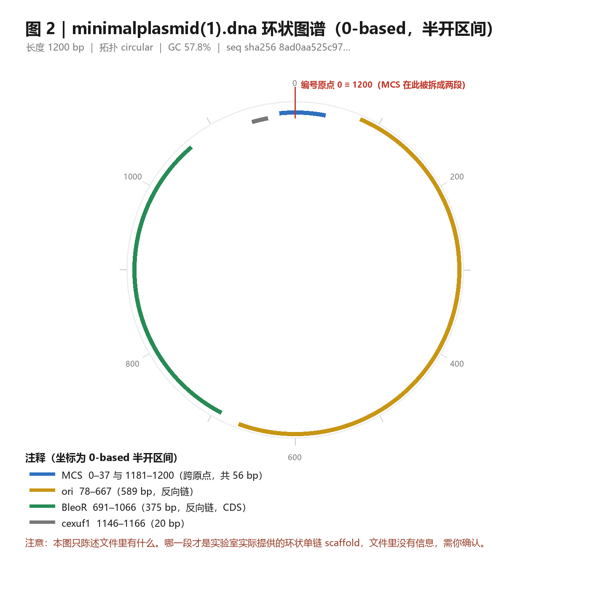
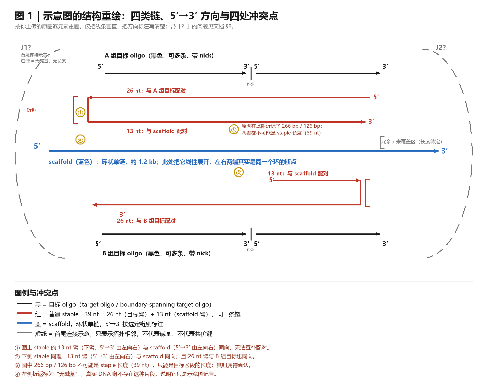
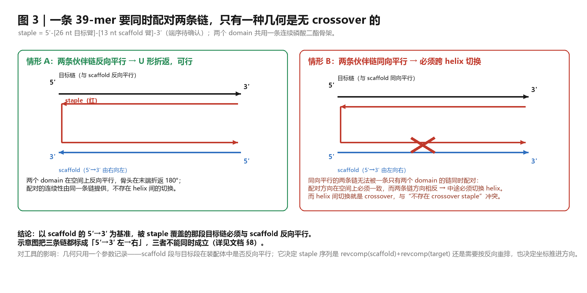

# 阶段 0｜结构理解与待确认问题

> 阅读顺序：先看 §0 的结论，再看 §8 的矛盾清单，最后回答 §10 的 10 个问题。
> **本轮没有生成任何实验序列，也没有补全任何参数。** 所有未知项在 `params/project.params.json` 里显式留 `null`，
> 由 `tools/check_params.py` 拦截：目前有 **38 个阻塞项**，工具会拒绝往下走。

---

## 0. 结论先行

**我对结构的理解，一句话**：一条约 1.2 kb 的环状单链 scaffold 作为"骨架"，用一批统一的 39 nt staple
（13 nt 贴 scaffold + 26 nt 贴目标）把目标序列"钉"在 scaffold 旁边；目标是 A、B 两组带 nick 的短 oligo，
两组各对接一次形成闭合环，接缝处用跨界的 target oligo 覆盖。

**三条必须先解决的结论**（细节在 §8）：

1. **示意图把三条链都标成「5′→3′ 左→右」，这在几何上不能同时成立。** 一条只有两个 domain 的 39-mer
   要与两条链都配对，这两条链必须**反向平行**（证明见图 3）。三条同向 → 至少有一方的方向标注要相对另外两方翻转。
   这一条不定，staple 序列连第一个碱基都写不出来。
2. **266 bp / 126 bp 不可能是 staple 长度**（staple 是 39 nt）。它们只能是目标区段的长度，但到底标的是哪一段、
   两段之和（392 bp）是不是整个目标环长，需要你确认 —— 这决定整个设计的规模（多少条 staple、多少条 target oligo）。
3. **"此段无碱基、仅示意连接、无长度"** 在真实 DNA 链里不存在。这句话只能是画图记号；但它所在的折返处究竟是
   "一条 39-mer 的 U 形折返"还是"两条链首尾相接"，两者对应的化学结构完全不同（前者 1 个磷酸二酯键，后者是 3′-3′ 或 5′-5′ 键）。

---

## 1. 输入文件解析结果（事实，不含推断）

### 1.1 解析结果

| 项 | 值 |
|---|---|
| 文件 | `minimalplasmid(1).dna`（22 716 字节） |
| sha256 | `5f09e2f4cdd0983eebc8952023bcb0ef54cdfae639afa88f6bc58b6e76205836` |
| 序列长度 | **1200 bp** |
| 拓扑 | **circular**（序列块标志位 bit0 = 1） |
| 碱基组成 | A/C/G/T，GC = 57.8% |
| 首 / 末碱基 | 第 1 位 `T`，第 1200 位 `G`（编号原点落在 MCS 内部） |
| 容器结构 | 头部 19 字节 + 11 个数据块（见附录 A） |
| 文件备注 | `Type=Synthetic`、`ConfirmedExperimentally=0`、`SequenceClass=UNA`、创建 2021-03-14、最后修改 2023-12-19 |

坐标一律 **0-based、左闭右开**；SnapGene 文件内部是 1-based 闭区间，转换只在
`tools/snapgene_reader.py::parse_feature_ranges` 里发生一次，原始字符串保留在 `segments[].raw` 里以便逐条核对。

### 1.2 注释清单（0-based 半开区间）

| 名称 | 类型 | 坐标 `[start, end)` | 长度 | 链 | 文件原始区间 | 备注 |
|---|---|---|---|---|---|---|
| MCS | misc_feature | `[0, 37)` + `[1181, 1200)` | 56 | 无 | `1-37`、`1182-1200` | pUC18/19 多克隆位点，**跨原点**，被拆成两段 |
| ori | rep_origin | `[78, 667)` | 589 | − | `79-667` | ColE1/pMB1/pBR322/pUC 高拷贝复制起点 |
| BleoR | CDS | `[691, 1066)` | 375 | − | `692-1066` | 博来霉素/Zeocin 抗性，读框 −1，翻译 125 aa |
| cexuf1 | misc_feature | `[1146, 1166)` | 20 | 无 | `1147-1166` | 文件里没有注释说明，名称不透明 |

另有 5 条引物记录（`测序-f2`、`F1`、`F2`、`R1`、`R10`，20–120 nt）。**它们是克隆/测序引物，不是本项目的 staple**，
不要混进设计输出里。

### 1.3 我怎么确认"读对了"

解析器不是"看起来能跑"，四条硬校验（`tests/test_snapgene_reader.py`，共 26 个测试全部通过）：

1. **链别语义**：BleoR 的 375 nt 片段只有取**反向互补**后再按 0 框翻译，才得到文件里记录的 125 aa 的翻译；
   正链读框得到的是无意义的氨基酸串。这一条同时锁定了两件事：`directionality="2"` 就是反链、
   `1-based 闭区间 → 0-based 半开`的换算是正确的。测试：`test_bleor_translation_only_works_on_reverse_strand`。
2. **环状处理**：MCS 在文件里被写成 `1-37` 与 `1182-1200` 两段；跨原点拼接后应连续。
   测试：`test_mcs_is_split_across_the_origin`、`test_wrap_slicing_matches_naive_concatenation`（14 个起点 × 5 个长度全比对）。
3. **不改写**：原始序列字节串必须原样出现在文件里；读前读后文件 sha256 不变。
   测试：`test_sequence_is_returned_verbatim`、`test_reader_does_not_modify_input`。
4. **坏文件必须报错**：非 SnapGene 文件、截断文件都要抛 `SnapGeneError`，不能"尽力而为"地读出一半。

### 1.4 文件里三件必须提醒你的事

1. **`ConfirmedExperimentally=0`、`Type=Synthetic`。** 这是一条**设计记录**，不是你测序验证过的实物序列。
   如果实验室实际拿到的环状 ssDNA 与它对不上，后面所有坐标都要重来。建议你确认：这条 1200 nt 是否就是实测序列。
2. **文件里没有 f1/M13 单链复制原点**（只有 ColE1 ori + BleoR + MCS + 一个不明的 20 nt 特征）。
   也就是说，**这个文件本身解释不了"怎样从这个质粒得到环状单链"**。scaffold 是体外环化的？还是另有一个含 f1 原点的版本？
   这不影响序列设计，但影响"这条 1.2 kb ssDNA 的 5′ 端在哪里"—— 而 5′ 端位置正是所有环状坐标的原点。
3. **编号原点落在 MCS 内部**（第 1 位是 MCS 的中段）。所以注释看起来"错位"是文件编号约定，不是序列有问题。
   我的工具以 `[0, 1200)` 为坐标，不跟随任何"生物学起点"的直觉。

> ⚠️ **我没有做的事**：我没有把整段 1200 nt 认定为 scaffold。文件只提供了一条环状**双链**质粒序列，
> 从中无法判断实验室的环状**单链**是正链还是负链、覆盖哪一段。这两件事必须由你指定（Q2、Q3）。



---

## 2. 结构复述（用我自己的话）

### 2.1 三层结构

这套设计可以拆成三层，**层与层之间只靠碱基互补联系，不靠共价键**：

| 层 | 组成 | 作用 |
|---|---|---|
| 骨架层 | scaffold（环状 ssDNA，约 1.2 kb） | 提供"坐标系"和"位置"，本身不参与目标序列的信息 |
| 桥接层 | 普通 staple（39 nt，统一设计） | 每条 staple 一手抓 scaffold（13 nt）、一手抓目标（26 nt），把目标钉在 scaffold 的特定位置上 |
| 载荷层 | target oligo（A 组 + B 组，带 nick） | 承载真正的目标序列；最终要闭合成一条环状连续单链 |

### 2.2 装配体里谁在谁旁边（按图）

竖着看示意图，从上到下的顺序是：

```
A 组目标（黑，5′→3′ 左→右，带 nick）
   ↑ 26 nt 臂
staple（红，U 形折返）
   ↓ 13 nt 臂
scaffold（蓝，5′→3′ 左→右）        ← 中间层
   ↑ 13 nt 臂
staple（红，U 形折返）
   ↓ 26 nt 臂
B 组目标（黑，5′→3′ 左→右，带 nick）
```

也就是说：**scaffold 在中间，A 组目标在一侧，B 组目标在另一侧**，两侧各有一批 staple 把目标拉向 scaffold。
A 侧的 U 形折返画在左端，B 侧的 U 形折返画在右端 —— 这个细节很重要，它说明两侧的 staple 是"从不同端绕过去"的，
不是同一端。

### 2.3 怎么理解 13 nt / 26 nt 这个不对称

我的理解（**是理解，不是事实**，请你纠正）：13 nt 对 1.2 kb 的 scaffold 来说很短，单独一条 staple 的 13 nt duplex
在室温下稳定性有限，靠几十条 staple 的**协同（avidity）**把整段目标固定住；26 nt 对目标更长，负责"认准这一段"。
所以真正决定结构的是"staple 排布密度"，而不是单条 staple 的强度。这一点直接对应 §9 里的 `staple.scaffold_pitch`。

---

## 3. 每条链的 5′→3′ 方向

| 链 | 图中标注 | 我的读法 | 备注 |
|---|---|---|---|
| scaffold（蓝） | 5′ 在左、3′ 在右 | **5′→3′ 由左向右** | 环状，图中线性展开；左右两端是同一个环的断点，不是末端 |
| A 组目标（黑，上） | 两条 oligo 都 5′ 在左、3′ 在右，中间一个 nick | **5′→3′ 由左向右** | nick 处是前一条的 3′ 接后一条的 5′ |
| B 组目标（黑，下） | 同上 | **5′→3′ 由左向右** | 与 A 组标注完全相同 |
| 上侧 staple（红） | 上臂 5′ 在右、3′ 在左；下臂 3′ 在右 | 上臂 **5′→3′ 由右向左**；下臂 **5′→3′ 由左向右** | 两臂**反向平行**，左端 U 形折返 |
| 下侧 staple（红） | 上臂 5′ 在左；下臂 3′ 在左 | 上臂 **5′→3′ 由左向右**；下臂 **5′→3′ 由右向左** | 两臂反向平行，右端 U 形折返 |



**注意第 2、3 行和第 1 行**：三条链全被标成"5′→3′ 左→右"。这不是小问题，见 §8 的 M1。

---

## 4. 四类链的区分

| 类别 | 是什么 | 谁合成 | 长度 | 方向 | 在装配体里的角色 | 工具里的类型名 |
|---|---|---|---|---|---|---|
| **scaffold** | 一条环状单链 DNA，实验室提供 | 实验室现成 | 约 1200 nt | 环状，有 5′/3′ 但两端相连 | 坐标系与定位平台；**可以有一段完全不参与** | `Scaffold` |
| **普通 staple** | 39 nt 单链 oligo，13+26 两段连续 | 商业合成 | 39 nt | 一条链，5′→3′ 明确 | 桥：一端贴 scaffold、一端贴目标 | `Staple` |
| **target oligo** | 目标序列的一段，落在目标环坐标系的某个区间内 | 商业合成 | 待定（由 Q7 推出） | 与装配体中所在链一致 | 载荷的一段；相邻 oligo 之间是 nick（3′-OH / 5′-P 相邻但**不共价**） | `TargetOligo` |
| **boundary-spanning target oligo** | 同上，**但它的区间跨过了一个 A/B 交界** | 商业合成 | 待定 | 同上 | 让"交界处的序列"仍然由一条真实 oligo 覆盖 | `TargetOligo`（`spans_junction=(J1,)`） |

**boundary-spanning oligo 的关键**：它不是"互补桥接链"，也不是两条 oligo 拼起来。它的序列就是**目标环上跨过交界的一段连续序列**
（A 的尾 + B 的头），因为交界两侧在目标环坐标系里本来就是相邻的两个区间。它之所以特殊，只是因为**这一段序列在化学上由一条 oligo 覆盖**，
而交界处的磷酸二酯键是否真的形成，是**另一层记录**（见 §7）。

这个理解带来一个很有用的简化：**在目标环坐标系里，boundary-spanning oligo 和普通 oligo 没有类型差别**，
只是它的区间跨过了某个 junction 坐标。"跨界"是一个**可由坐标算出来的属性**，不是一个需要手工标注的类型。
普通 staple 与它无关 —— 你说得对，特殊设计只作用于 target oligo，staple 保持统一。

---

## 5. 13 nt 与 26 nt 属于哪条链的哪个 domain

- **两者都在 staple 上，是同一条链上连续的两段。** 不是两条 oligo、不是两个分子、中间没有 nick。
- **13 nt = scaffold-binding domain**：与 scaffold 上 `[p, p+13)` 这段**反向互补**。
- **26 nt = target-binding domain**：与目标链上 `[q, q+26)` 这段**反向互补**。
- **端序未定**：13 nt 靠近 staple 的 5′ 端还是 3′ 端，示意图没有说，我不猜（`geometry.staple_domain_order`）。
  两种写法在序列上是 `revcomp(target26) + revcomp(scaffold13)` 与它的反向排列，工具必须能表达两种。
- **两者的交界处不是"无碱基连接"**，而是一个**磷酸二酯键 + 一个约 180° 的骨架转角**（U 形折返）。
  这个转角是本设计里唯一"被拉紧"的地方，阶段 6 的二级结构/能量分析要专门看它。

一个可直接量化的事实：13 nt 的序列空间是 4¹³ ≈ 6.7×10⁷，在 1200 nt 上随机期望重复次数约 **0.002**，
所以 13-mer 在 1.2 kb 上几乎必然唯一 —— 但仍会做唯一性检查（不靠概率假设）。

---

## 6. 两个 A/B 交界：位置与连接关系

### 6.1 位置

示意图用**虚线**画了两处首尾连接（我标为 J1、J2）。虚线在图上没有长度，说明它们不代表碱基，只表示"这两端在装配体里是相邻的"。

- **J1**（你明确给出的那一处）：A 的**尾端 3′** 与 B 的**首端 5′**。
- **J2**（由"闭合环"推出，需要你确认）：B 的**尾端 3′** 与 A 的**首端 5′**。闭合环只有两个断口，另一个必然是这个方向。

### 6.2 连接关系记录表（每个 nick / junction 单独一行，不合并、不推断）

| ID | 左段 | 左端 | 右段 | 右端 | 相邻？ | 共价？ | 5′-P | 3′-OH | 处置 |
|---|---|---|---|---|---|---|---|---|---|
| J1 | A 组末尾 oligo | **3′** | B 组首个 oligo | **5′** | 待定 | **否**（默认按 nick 记录） | 待定（Q10） | 是 | 由 boundary-spanning oligo 覆盖序列；键的形成单独记录 |
| J2 | B 组末尾 oligo | **3′** | A 组首个 oligo | **5′** | 待定 | **否** | 待定（Q10） | 是 | 同上 |
| N1…Nk | 组内相邻 oligo | **3′** | 组内下一条 | **5′** | 是 | **否** | 待定（Q10） | 是 | 保持 nick；**位置不得落在两条 staple 之间**（你给的硬约束） |

### 6.3 为什么这里特别容易出错

**"序列覆盖连续"不等于"共价骨架已经连接"。** 举例：一条 boundary-spanning oligo 完整覆盖了 J1 两侧各 15 nt，
在目标环坐标系里 `[j-15, j+15)` 是连续的 —— 但这条 oligo 是**一条**链，它内部根本没有断点；
而 J1 这个"断点"本来只存在于**设计意图**里（A 段和 B 段分两次合成）。
所以 J1 到底是不是一个"nick"，取决于你怎么定义 A/B 的分界，而不是取决于序列。

**"杂交配对"也不等于上面任何一个。** staple 的 26 nt 与目标互补配对，形成的是**氢键**，
它既不改变化学连接，也不代表序列连续（两条链方向相反、在两个不同坐标系里）。

**"共价连接"必须单独记录。** 工具里 `Bond` 是一个独立对象，默认状态是 `nick`（相邻但不共价），
只有显式写成 `ligated` 才认为成键。任何"因为坐标相邻所以算连上了"的推断，在代码里都是禁止的。

---

## 7. 三种"连接"如何区分（工具的实现约定）

### 7.1 三个正交的层

| 层 | 回答的问题 | 数据结构 | 判据 |
|---|---|---|---|
| **序列连续** | 这两段序列在设计上是不是首尾相接？ | `Segment {molecule, start, end, strand}` | 同一坐标系下 `end₁ == start₂` 且方向相同 |
| **互补配对** | 这两段是不是靠氢键配在一起？ | `Hybridization {a_domain, b_domain, mismatches, ΔG}` | `revcomp(a.seq) == b.seq` 且方向相反 |
| **共价连接** | 这两个末端之间有没有磷酸二酯键？ | `Bond {left_molecule, left_end=3′, right_molecule, right_end=5′, state}` | **只**来自显式记录：`none` / `nick` / `ligated` |

### 7.2 一条 nick 的完整记录长这样（示意，非真实坐标）

```json
{
  "bond_id": "N3",
  "left":  {"oligo": "T_A_03", "end": "3'", "chem": "3'-OH"},
  "right": {"oligo": "T_A_04", "end": "5'", "chem": "5'-P"},
  "adjacent": true,
  "state": "nick",
  "in_staple_gap": false,
  "note": "同组内 nick；两侧均由 staple 覆盖，不在两条 staple 之间"
}
```

关键点：`adjacent: true` 只说明坐标相邻；`state: "nick"` 才说明"没有共价键"；`in_staple_gap` 是你那条硬约束的直接落地
（false 才合法）。三者缺一，报告就不完整。

### 7.3 因此工具会产出的三张"关系表"

1. `placements`：每条 staple 的 13 nt 落在 scaffold 的哪个区间、26 nt 落在目标的哪个区间、方向如何；
2. `hybridization`：每一对互补区段（staple↔scaffold、staple↔target），含错配数与预计 ΔG；
3. `bonds`：每一个 3′/5′ 相邻点，含 `state` 与化学端基状态。

实验人员看 `bonds` 表就知道"哪些地方要连接、哪些地方保持 nick"，不会被"看起来连续"误导。

---

## 8. 与示意图 / 文字 / 文件之间的 5 处矛盾

### M1（最高优先级）｜三条链都标「5′→3′ 左→右」与「一条 staple 同时配对两者」冲突

**现象**：scaffold、A 组目标、B 组目标在图上全部是 5′ 在左、3′ 在右。

**为什么是矛盾**：一条只有两个 domain 的链，若要分别与两条链互补配对，它的两个 domain 在空间上必须取向相反
（一个由右向左、一个由左向右）—— 这正是 U 形折返。取向相反 ⇒ **两条伙伴链也必须反向平行**。
三条同向时，至少有一条配不上（图 3 给了证明）。

**对程序的影响**：这决定 staple 序列的拼接公式和坐标推进方向。方向不定，**第一条 staple 的序列就无法写出**。
它同时决定两个 junction 落在哪一端，从而决定 boundary oligo 的区间。

**需要你定**：以 scaffold 的 5′→3′ 为基准，A 组、B 组目标在装配体里是**反向平行**还是**同向平行**？（Q1）



### M2｜266 bp / 126 bp 与「staple 39 nt」冲突

**现象**：红色（= staple）旁边标了 `266 bp` 和 `126 bp`。

**为什么是矛盾**：staple 是 39 nt，不可能有 266 或 126 的长度。这两个数只能是**目标区段**的长度。

**对程序的影响**：如果 A 区 266 bp、B 区 126 bp、目标环长 392 bp，那么 staple 条数 ≈ 392/间距、target oligo 条数也定了；
如果这两个数只是"其中一小段"，整个规模会完全不同。**规模不定，生成器无法分配编号、无法算覆盖。**

**需要你定**：这两个数分别指哪一段？两段之和是否就是目标环的总长？（Q7、Q8）

### M3｜「此段无碱基 / 仅示意连接 / 无长度」与「staple 是真实 DNA 链」冲突

**现象**：左侧红色括号处注明折返段"无碱基、仅示意连接、无长度"。

**为什么是矛盾**：真实的 DNA 链没有"无碱基的连接段"这种结构。这句话只能是示意图的记号。
但问题在于：如果折返处不是一条链的转角，而是**两条 staple 之间的空隙**，那么图上那个 U 形就不是一条链，
而是两条链首尾相望 —— 那它们之间是 3′-3′ 还是 5′-5′ 连接？两者在化学上都不存在。

**对程序的影响**：决定 U 形是"一条 39-mer 的折返"还是"两条 39-mer + 空隙"。前者按 §5 处理；
后者则完全不是 39 nt 的设计，13/26 的长度分配也要重算。

**需要你定**：这个折返是**一条 staple 自己的转角**（我理解是这样），还是两条 staple 之间的空隙？（Q5）

### M4｜A、B 两组都「5′→3′ 左→右」与「A 的 3′ 接 B 的 5′」在位置上冲突

**现象**：A 组在图上 5′ 在左、3′ 在右；B 组同样 5′ 在左。而你明确说 J1 是"A 的尾部 3′ 接 B 的首端 5′"。

**为什么是矛盾**：A 的 3′ 在**右端**，B 的 5′ 在**左端**，两者在图上隔着整个结构宽度，不可能是"首尾相邻"。
除非 B 组在装配体里被**反向放置**（即图示方向与装配方向相反）。

**对程序的影响**：决定 junction 的坐标，以及 boundary oligo 的组成是"A 段 + B 段直接串联"还是"A 段 + 反向的 B 段"。
这条与 M1 是同一个根因的两个表现。

**需要你定**：B 组在装配体里的实际方向（Q1 一并回答）。

### M5｜文件（双链质粒）与文字（环状单链）之间的矛盾

**现象**：文件是一条 1200 bp 环状**双链**质粒，含 ColE1 ori、BleoR、MCS，且 `ConfirmedExperimentally=0`、无 f1/M13 原点；
文字说实验室提供的是约 1.2 kb 环状**单链**。

**为什么是矛盾**：文件本身既不能证明"这条单链就是这个序列"，也不能解释"如何产生单链"。文件是**设计记录**，不是实物证据。

**对程序的影响**：不影响算法，但影响结论的可信度。如果实际 scaffold 与文件不一致，所有坐标与 staple 序列全部作废。
工具会把 sha256 写进每份输出，保证"这批序列是基于哪个文件算的"可追溯。

**需要你定**：这条 1200 nt 是否就是实测 scaffold 的序列？scaffold 的 5′ 端对应文件里的哪个位置（Q2、Q3）？

---

## 9. 无法从现有材料确定的参数

分组列出。`params/project.params.json` 里同名键为 `null`，`tools/check_params.py` 会拦截。
"为什么必须由你定"一列说明：为什么不能靠默认值或推断过去。

### A. scaffold 本身

| 参数 | 为什么必须由你定 |
|---|---|
| `scaffold.strand` | 文件是双链，正链/负链的碱基完全不同；选错则所有 13-mer 全错 |
| `scaffold.region` | 可能是整段 1200 nt，也可能只有其中一段 |
| `scaffold.covered_arc` | 被 staple 连续覆盖的那一段；决定冗余段落在哪里 |
| `scaffold.redundancy_policy` | 冗余段留在一端还是两侧分开 |

### B. 几何与方向（阻塞级别最高）

| 参数 | 为什么必须由你定 |
|---|---|
| `geometry.target_vs_scaffold` | 反向平行 / 同向平行，决定 staple 序列拼接与坐标推进（M1） |
| `geometry.staple_domain_order` | 26 nt 与 13 nt 谁靠 5′ 端 |
| `geometry.junction_geometry` | U 形折返 / 横档式，决定是否需要 helix 间切换（M1、M3） |

### C. 规模与排布

| 参数 | 为什么必须由你定 |
|---|---|
| `staple.scaffold_pitch` | 相邻 staple 在 scaffold 上的间隔；决定条数与覆盖密度 |
| `staple.max_count` / 是否允许 domain 重叠 | 影响成本与是否出现重叠配对 |
| `target.group_A_length` / `group_B_length` | 图中 266 / 126 的归属（M2） |
| `target.circle_length` | 闭合环总长，决定编号与 junction 位置 |
| `target.oligo_count_per_group` / `oligo_length_range` | 合成 oligo 的条数与长度上限（成本与合成可行性） |
| `target.nick_positions` | 你的硬约束：nick 不得落在两条 staple 之间；具体位置需与 pitch 联立 |

### D. 化学与连接

| 参数 | 为什么必须由你定 |
|---|---|
| `junctions.J1/J2` 的左右段与端别 | 只固定了 J1 一种组合，J2 需按闭合环推出（M4） |
| `junctions.*.bond_state` | nick 保持 / 计划连接 / 只是设计意图 |
| `chemistry.five_prime_phosphate_on_target` | 化学合成 oligo 默认 5′-OH，连接前需磷酸化；这直接写进 bonds 表 |
| `chemistry.ligation_planned` / `kinase_treatment` | 决定实验流程与"最终是否真的成环" |

### E. 分析与输出

| 参数 | 为什么必须由你定 |
|---|---|
| 缓冲液 Na⁺/Mg²⁺、温度、oligo 浓度 | 没有这些，ΔG、Tm、"是否稳定"全部无从计算 |
| 二级结构阈值、是否允许外部工具 | 决定阶段 6 的判据与依赖（ViennaRNA/NUPACK 是否可装） |
| 输出格式细节 | 可以给默认值，不阻塞 |

---

## 10. 提问清单（按阻塞优先级排序）

**Q1（最高）** 以 scaffold 的 5′→3′ 为基准，A 组、B 组目标链在装配体里是**反向平行**还是**同向平行**？
如果三者确实同向，那 staple 的两个 domain 之间就必须发生一次 helix 间切换 —— 这是否就是你说的"不存在 crossover staple"想要排除的东西？

**Q2** 实验室的环状单链 scaffold 对应文件里的**正链**还是**负链**？（即：`seq` 还是 `revcomp(seq)`）

**Q3** scaffold 是**整段 1200 nt**，还是只有其中一段？若是后者，给出区间（并说明 5′ 端对应哪个位置）。

**Q4** scaffold 上**连续被 staple 覆盖**的是哪一段？冗余段希望留在 5′ 侧、3′ 侧，还是两侧分？

**Q5** 图中红色 U 形的折返，是**一条 staple 自己的转角**，还是**两条 staple 之间的空隙**？（对应 M3）

**Q6** 相邻 staple 在 scaffold 上的**间距**是多少（13 nt 结合位点 + 多少 nt 空隙）？或者：希望总共多少条 staple？

**Q7** `266 bp` 和 `126 bp` 分别指哪一段？（A 组长度 / B 组长度 / 某个子区间 / 其它）

**Q8** 目标任务片段闭合后的**总长**是多少？是否就是 `266 + 126 = 392 bp`？

**Q9** J1 = A 的 3′ 接 B 的 5′。那 **J2** 是不是 B 的 3′ 接 A 的 5′？两个交界分别落在结构的哪一端？

**Q10** 目标 oligo 合成后是否做 **5′ 磷酸化**？两个交界打算**保持 nick** 还是**用 ligase 连上**？
（这决定 `bonds` 表里 `state` 与 `chem` 两列怎么写，也决定实验流程）

**Q11（次要）** 目标 oligo 的长度上限是多少（合成成本/纯度考虑）？每组的条数有要求吗？

**Q12（次要）** 阶段 6 的热力学分析，能否安装 ViennaRNA 或 NUPACK？打算在什么缓冲液/温度下评估？

---

## 11. 阶段计划：什么时候才会写"序列生成"代码

| 阶段 | 内容 | 现在能不能开始 |
|---|---|---|
| 1 | 输入解析 + 数据模型 | ✅ 已完成只读部分（`tools/snapgene_reader.py`，26 个测试） |
| 2 | scaffold ↔ 目标映射 | ⛔ 卡在 Q1–Q4（坐标系与方向） |
| 3 | staple 生成 | ⛔ 卡在 Q1、Q5、Q6 |
| 4 | target oligo 生成 | ⛔ 卡在 Q1、Q7–Q9 |
| 5 | 序列与结构验证 | 部分可写（互补/方向/覆盖检查不依赖未知参数） |
| 6 | 热力学 / 二级结构接口 | ⛔ 卡在 Q12 |
| 7 | 导出与可视化 | 部分可写（格式可先定） |
| 8 | 整体测试与文档 | 最后 |

**我的建议**：你先回答 Q1–Q5（这五个决定几何与坐标），我就能把阶段 2 的数据模型和阶段 5 的验证器先落地
（这两块不产生真实序列，只产生"结构骨架 + 检查报告"），再回答 Q6–Q10 才进入真正的序列生成。

---

## 12. 复现本阶段的结果

```powershell
$py = "C:\Users\MadeInHeaven\.dsh\dsh-runtimes\dsh-primary-runtime\dependencies\python\python.exe"

# 1) 解析 .dna，输出 JSON（含完整序列、注释、warnings）
& $py -m tools.snapgene_reader "minimalplasmid(1).dna" -o data/scaffold_minimalplasmid.json

# 2) 参数完整性检查（现在是 38 个阻塞项，退出码 2）
& $py tools/check_params.py

# 3) 重新生成三张图
& $py tools/make_figures.py

# 4) 单元测试（26 个）
& $py -m unittest discover -s tests -v
```

---

## 附录 A：文件数据块清单

| # | type | 偏移 | 长度 | 含义 |
|---|---|---|---|---|
| 1 | 0 | 0x0013 | 1201 | 序列（1 字节标志 + 1200 nt） |
| 2 | 2 | 0x04c9 | 3939 | 旧版特征二进制块 |
| 3 | 3 | 0x1431 | 8556 | 旧版特征/酶切二进制块 |
| 4 | 27 | 0x035a2 | 461 | gzip 压缩的历史记录 |
| 5 | 17 | 0x03774 | 45 | 比对序列设置 |
| 6 | 8 | 0x037a6 | 289 | 附加序列属性（平末端、5′ 磷酸化标记） |
| 7 | 10 | 0x038cc | 2443 | 特征 XML（本工具使用） |
| 8 | 5 | 0x0425c | 4968 | 引物 XML（本工具使用） |
| 9 | 6 | 0x055c9 | 354 | 备注 XML（本工具使用） |
| 10 | 13 | 0x05730 | 345 | 酶切集合 |
| 11 | 14 | 0x0588e | 41 | 自定义酶集合 |

## 附录 B：坐标约定速查

- 一切坐标 **0-based、左闭右开** `[start, end)`，长度 = `end - start`。
- 环状序列允许 `end > length`，表示跨原点；`subsequence()` 自动回绕。**不把跨原点区间悄悄拆成两段。**
- SnapGene 原始 `1-based 闭区间` 与 `range="a-b"` 字符串保留在 `segments[].raw`，任何输出都同时给两者，便于人工核对。
- 方向：`"+"` 表示与文件序列同向，`"-"` 表示反向互补。
