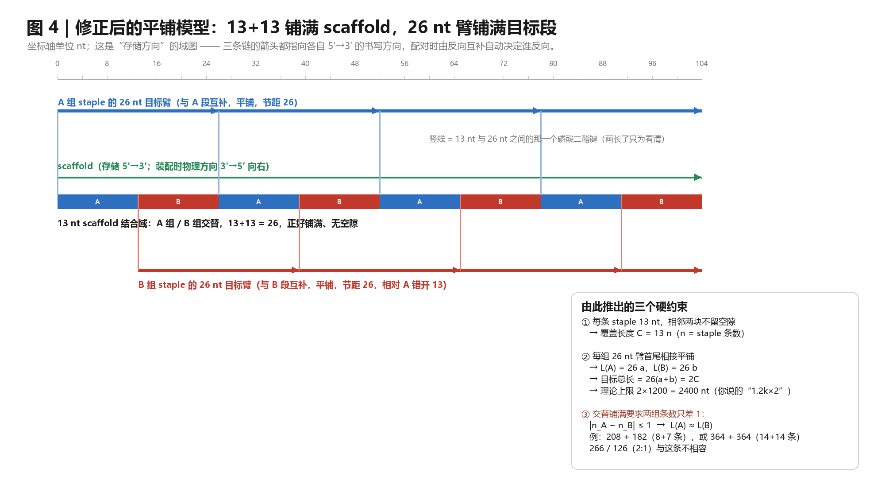

# 阶段 0.5｜结构确认（v2）：修正后的几何与平铺模型

> 本文替代 `00_结构理解与待确认问题.md` 中的 §2–§6 与 §8 的结论部分；v1 文档保留作为提问记录。
> 你的第二张图与文字修正，把 v1 里最阻塞的 M1 解掉了，同时纠正了我两个画错的地方。

## 0. 我的两个错误（已修正）

| 我画错的 | 实际情况 |
|---|---|
| 上侧 A 组 staple 的 13 nt 臂画了几乎一整条 scaffold 的长度，下侧 B 组同样长 | 两组 staple 的 13 nt 域**交替平铺**：A 占一块 13 nt，B 占紧邻的 13 nt，**13+13 = 26 正好铺满**，谁也不侵占谁 |
| 把"此段无碱基"当成真实结构去质疑 | 那只是把 13 nt 与 26 nt 之间的**一个磷酸二酯键画长了**（你的原话），没有第四种结构 |

## 1. 修正后的模型（一句话 + 三条）

**一句话**：scaffold 被 13 nt 一块地铺满，相邻两块交替属于 A 组与 B 组 staple；A 组 staple 的另一半（26 nt）连续平铺在 A 段目标上，B 组同理铺在 B 段上；两条目标段再用两个交界拼成环。

三条关键：

1. **所有箭头都表示"存储方向的 5′→3′"，不是配对方向。** 配对方向由反向互补自动决定。
2. **装配体里 scaffold 是反向的那一条**：物理 3′→5′ 由左向右；A、B 两条目标链是 5′→3′ 由左向右。
3. 于是每条 staple 的两个 domain **反向平行**：13 nt 由左向右走，26 nt 由右向左走，折返在左端 —— 这正是一条只有两个 domain 的链能桥接两条链的唯一无 crossover 几何（v1 图 3 的证明仍然成立，现在被满足了）。

## 2. 每条链的 5′→3′（修正后）

| 链 | 存储/书写方向 | **装配体中的物理方向** | 图上的箭头 |
|---|---|---|---|
| scaffold | 5′→3′（文件里就是这个顺序） | **3′→5′ 由左向右**（3′ 在左） | 箭头指向存储的 3′ 侧 |
| A 段目标 | 5′→3′ | 5′→3′ 由左向右 | 同 |
| B 段目标 | 5′→3′ | 5′→3′ 由左向右 | 同 |
| A 组 staple | 5′→3′ | 26 nt 臂由右向左、13 nt 域由左向右 | 箭头只标 domain 的书写方向 |
| B 组 staple | 5′→3′ | 同上 | 同上 |

## 3. 坐标与序列：第一个碱基怎么算

设 scaffold 被覆盖的区段（存储坐标、环状）为 `[a, b)`，覆盖长度 `C = (b - a) mod 1200`。

以"绘图坐标" `p`（0 = 覆盖区最左端，向右递增）为基准：

```
scaffold 存储坐标：      s(p) = b - 1 - p            （因为物理 3′ 在左，存储 5′ 在右）
A 组第 k 条 staple：
    13 nt 域（staple 的 3′ 端一侧）  = revcomp( scaffold[ b-26k-13 : b-26k ] )
    26 nt 臂（staple 的 5′ 端一侧）  = revcomp( A[ 26k : 26k+26 ] )
    staple_k = 5'-[26 nt 臂]-[13 nt 域]-3'
B 组第 k 条 staple：
    13 nt 域 = revcomp( scaffold[ b-26k-26 : b-26k-13 ] )
    26 nt 臂 = revcomp( B[ 26k : 26k+26 ] )
```

两点说明：

- 26 nt 臂在 5′ 侧、13 nt 域在 3′ 侧，是**按你图上折返画在左端**推出来的（左端连接 26 nt 的 3′ 与 13 nt 的 5′）。若折返在右端，两条 domain 互换端序即可，工具会把它做成参数。
- `revcomp` 是唯一的"翻向"动作；所有存储、输出、FASTA 一律 5′→3′，不出现"反向序列"。



## 4. 平铺算术：三条硬约束

因为两侧都是**铺满、无空隙**的，规模不是自由参数：

| 约束 | 由来 |
|---|---|
| `C = 13 n` | 每条 staple 占 13 nt scaffold，相邻不留空隙；n = staple 总条数 |
| `L(A) = 26 a`，`L(B) = 26 b` | 每组 26 nt 臂首尾相接平铺（a、b = 两组条数，`n = a + b`） |
| **`L(目标总长) = 26(a+b) = 2C`** | 两条合一；理论极限 `2 × 1200 = 2400 nt`（你说的"1.2k×2"） |

**于是 266 / 126 这两个数不自洽**：

```
L = 266 + 126 = 392
C = L / 2 = 196
n = 196 / 13 = 15.08   ← 不是整数
a = 266 / 26 = 10.23   ← 不是整数
b = 126 / 26 = 4.85    ← 不是整数
```

最近的自洽解：**A = 260，B = 130** → `a = 10, b = 5, n = 15, C = 195, L = 390`。
（另一组：A = 286, B = 130 → a=11, b=5, n=16, C=208, L=416。）

这不是吹毛求疵：`n` 必须是整数，才能决定 staple 条数、编号、以及两个交界落在哪个坐标上。

## 5. "nick 不能落在两条 staple 之间"怎么落地

既然 scaffold 侧 13+13 已经铺满，**物理上不再存在"臂与臂之间的空隙"**；真正的"缝"是**相邻两条 staple 臂的接缝**，位于目标坐标的 `26k` 处（k = 1, 2, …）。

因此你那条约束我理解为两条可判定的规则：

1. **每个 target oligo 的 nick 不得落在目标坐标 `26k` 处**（不能正好落在两条 staple 臂的接缝上）；
2. **每条 target oligo 至少跨过一个 `26k` 接缝**（即 oligo 长度 > 26，且区间内部含有至少一个 26 的倍数）。

这两条都能在坐标上直接判定，会写成阶段 5 的验证器规则 `nick_not_at_staple_seam` 与 `oligo_spans_staple_seam`。
**如果我的理解不对，请纠正**——这是"设计意图"层面的约束，不能靠猜。

## 6. 还没确定的（更新后的短清单）

| # | 事项 | 现状 |
|---|---|---|
| 1 | scaffold 是文件的正链还是负链 | 你说待定（Q2） |
| 2 | A、B 两段的目标长度 | 需为 26 的倍数；266/126 需调整或解释 |
| 3 | 两个交界在目标环上的坐标 | 只有"上面 3′ 接下面 5′"这一条已定；另一个由闭合环推出，但具体落在哪一段的哪一端未定 |
| 4 | 先做成环还是先做线性 | 你说先考虑成环 |
| 5 | 折返端（26 nt 在 5′ 侧还是 13 nt 在 5′ 侧） | 按图推定 26 nt 在 5′ 侧，待你一句确认 |
| 6 | 是否 5′ 磷酸化、是否用 ligase 封口 | 未定（影响 `bonds` 表的化学列） |
| 7 | target oligo 的条数与长度上限 | 未定 |
| 8 | 热力学条件（缓冲液/温度） | 未定，阶段 6 才需要 |

## 7. v1 矛盾的处置

| 编号 | 状态 |
|---|---|
| M1 三条链同向不可能 | **已解决**：scaffold 装配时 3′→5′，是反向的那一条；箭头只是书写方向 |
| M2 266/126 bp | **转为算术问题**：见 §4，需要改成 26 的倍数 |
| M3 "此段无碱基" | **已解决**：只是把磷酸二酯键画长了 |
| M4 A 的 3′ 接 B 的 5′ | **序列层面已定**（A 的 3′ 接 B 的 5′，另一个交界由闭合环推出）；但两个交界在装配体的**哪个物理位置**相遇（两端？折返处？）还没定 —— 你说"先不管首尾连接"，所以这一版先把序列覆盖与 staple 定位做对，几何闭合单独处理 |
| M5 文件是双链设计记录 | 仍待你确认链别与来源（Q2） |

## 8. 目标序列的规模预算（2026-11-17 讨论）

目标序列的长短**不是自由选的**，它被 scaffold 覆盖长度锁死：

```
C = 13n        每条 staple 铺 13 nt，n = staple 条数
C ≤ 1196       1200 不能被 13 整除：n 最大 92（13×92 = 1196），剩 4 nt 只能冗余
L = 2C = 26n   目标总长
⇒ |L| ≤ 2392   （不是 2400，因为 1200/13 不整除）
```

**结论：一个完整的酵母-大肠杆菌穿梭载体放不进来。** 典型 pRS 型载体约 5 kb，远超 2392。
所以"把复制位点、标记、启动子都塞进目标序列"这条路在本架构下走不通，不是软件问题，是尺寸问题。

可行的分层做法（推荐）：

| 层 | 内容 | 长度量级 | 是否进 target |
|---|---|---|---|
| 表达盒 | 启动子 + CDS + 终止子 | 1.3–1.5 kb | ✅ 进（这是"要装配的东西"） |
| 骨架 | ori / 标记 / 复制位点 | 2–4 kb | ❌ 不进（另走共转化或体外拼接） |
| 首个验证目标 | 只放 yEGFP CDS | 720 bp | ✅ 最小可行 |

长度对齐：720 不是 26 的倍数，余数 18 nt 正好可以由**两个交界处的 linker 吸收**（这也是"要不要 linker"这个问题的答案之一：
linker 不只是装饰，它是把长度对齐到 26 的整数倍的工具）。

**补充（2026-11-18）**：13+13 交替铺满要求 `|n_A − n_B| ≤ 1`，所以 `L(A) ≈ L(B)`。
若用 yEGFP CDS 720 nt → 补到 728 → `n = 28`、`A = 364`、`B = 364`、覆盖 364 nt（scaffold 的 30%）。
示意图上的 266 / 126 已确认为草图误差，不是设计意图。

