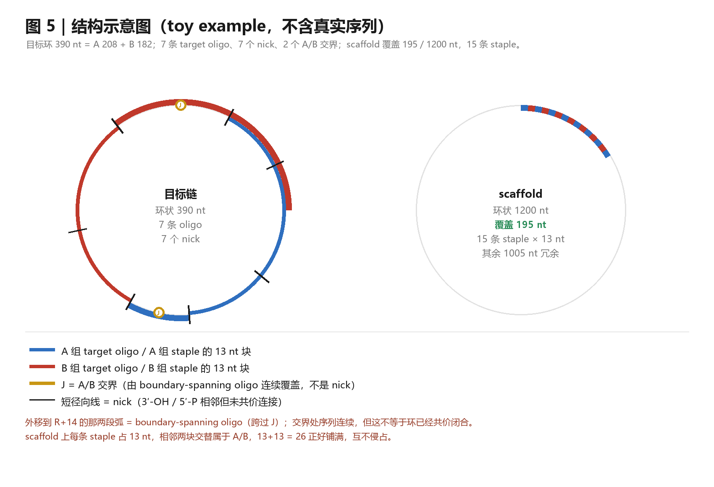

# Task B｜scaffold–staple–target 结构模型与映射

状态：**已完成**。只做结构表示与一致性检查，不优化序列、不模拟反应。

## 一、对任务书的判断（需要你确认的 5 处）

| # | 任务书写法 | 问题 | 我的处理 |
|---|---|---|---|
| 1 | `Staple` 只有 13/26 两个 region | 缺 `group`（服务 A 还是 B）与 `domain_order`（26 nt 在 5′ 侧），序列和坐标都对不上 | 补 `group`、`domain_order="5p_target_26"` |
| 2 | `TargetRegion.strand` | 没说是"相对谁的"方向 | 定义为相对**该分子**存储的 5′→3′（目标区域恒为 `+`）；跨分子的关系单独记为 `BindingSite.strand="-"`（与 staple 反向平行） |
| 3 | 只有 `Nick` | A/B 交界被 boundary oligo 连续覆盖时，交界处**不是 nick**，用一个 nick 表示会直接写错化学 | 新增 `Junction`，`bond_state ∈ {within_oligo, nick, ligated}` |
| 4 | `genomic_or_target_position` | 坐标系不明确 | 固定为目标坐标系（0-based 半开） |
| 5 | — | 13 nt 严格交替 ⇒ `n_A`、`n_B` 只差 1 ⇒ `L(A) ≈ L(B)`；示意图的 266/126 与之矛盾 | **已决（2026-11-18）**：用户确认 266/126 是草图误差，按 `L(A) ≈ L(B)` 处理；校验器仍会报 `group_length` |

## 二、数据结构

字段名与任务书**逐字对齐**（`test_mapping.py::TestSpecFieldNames` 会直接断言这些名字存在）：
`TargetRegion.region_id/sequence/start/end/strand/group`、
`TargetOligo.oligo_id/sequence/group/oligo_type/target_start/target_end/target_segments/strand/five_prime_modification/three_prime_modification`、
`Staple.staple_id/sequence/scaffold_binding_region/target_binding_region/scaffold_start/target_start/target_end/total_length`、
`Nick.nick_id/upstream_oligo/downstream_oligo/upstream_end/downstream_end/genomic_or_target_position/five_prime_phosphate/three_prime_hydroxyl/intended_ligation`。

```python
BindingSite(molecule, start, end, strand, molecule_length)
TargetRegion(region_id, group, start, end, strand, sequence, placeholder)
TargetOligo(oligo_id, group, oligo_type, sequence, start, end,
            target_segments[], strand,
            five_prime_modification, three_prime_modification)
Staple(staple_id, group, scaffold_binding, target_binding, sequence,
       domain_order, placeholder)          # total_length / scaffold_start / … 都是派生属性
Nick(nick_id, upstream_oligo, downstream_oligo, position,
     upstream_end, downstream_end, five_prime_phosphate,
     three_prime_hydroxyl, intended_ligation)
Junction(junction_id, position, upstream_group, downstream_group,
         upstream_end, downstream_end, covered_by, bond_state)
AssemblyPlan(config, regions, staples, oligos, nicks, junctions, checks)
```

坐标约定（装配层，与 Task A 的文件特征约定不同，已在 `models.py` 注明）：
`start ∈ [0, L)`、`length = end - start`、`end` 可以 ≥ L 表示跨原点、`wraps = end > L`。

## 三、映射算法

```
覆盖区 [a, a+C)，C = 13n，绘图坐标 p=0 在左端
第 j 块 scaffold 区间：  [a + C - 13j - 13,  a + C - 13j)      （存储坐标，跨原点取模）
第 j 条 staple 的分组：  group_pattern[j % len]
A 组第 k 条的目标臂：    target[26k, 26k+26)
B 组第 k 条的目标臂：    target[L_A + 26k, L_A + 26k + 26)
staple 序列：            5′-[revcomp(目标26)]-[revcomp(scaffold13)]-3′
```

三条推导出来的硬关系（不是假设，是校验器在查的）：

- `C = 13n`；
- `L(A) = 26·n_A`、`L(B) = 26·n_B`；
- `L(总) = 2C`，上限 2392（1200 不能被 13 整除）。

## 四、检查项（`validate_plan`，只报告不修复）

| code | 含义 |
|---|---|
| `scaffold_domain_length` / `target_domain_length` | 13 / 26 不符合 |
| `covered_length` / `covered_too_long` | `C ≠ 13n` 或超过 scaffold 长度 |
| `group_length` | 组长度 ≠ 26 × 条数（**266/126 会在这里报**） |
| `group_pattern` | 严格交替下两组条数差 > 1 |
| `oligo_gap` / `oligo_coverage` | 目标链有间隙/重叠，或环上总长不等于环长 |
| `nick_on_seam` | nick 落在 staple 臂接缝上 |
| `oligo_spans_no_seam` | 某条 oligo 没有跨过任何接缝 |
| `junction_coverage` / `junction_covered_by` | 交界被 0 条或多条覆盖、记录不一致 |
| `placeholder_sequences`（note） | 占位模式，互补性未评估 |
| `not_covalently_closed`（note） | 环状但所有 nick 都未连接 |

## 五、toy example

15 条 staple（A 8 + B 7），目标环 390 nt = A 208 + B 182，7 条 oligo、7 个 nick、2 个交界，
scaffold 覆盖 195 / 1200 nt，所有序列都是 `N` 占位符。

- 交界 J1（位置 208）由 `T04`（190–226）连续覆盖，J2（位置 0/390）由 `T07`（350–420）连续覆盖；
- `circle_closed = False`：**序列被连续覆盖 ≠ 共价闭合**；
- 7 个 nick 全部落在非接缝位置，每条 oligo 都跨过至少一个接缝。

真实序列模式（`placeholder=False`，需调用方传入序列）会按
`5′-[revcomp(目标26)]-[revcomp(scaffold13)]-3′` 真拼一遍，测试用一条**人工随机序列**验证互补关系，
没有使用任何真实基因序列。



## 六、测试结果

`python -m unittest discover -s tests` → **107 个测试全部通过**（Task B 占 41 个）。

覆盖：scaffold 平铺无缝无重叠与跨原点块、分组交替、13/26/39 长度、两组坐标不出界、
oligo 环状铺满与跨原点、两个 boundary oligo、交界被覆盖且不产生 nick、
nick 字段完整性、`circle_closed` 为 False、JSON 必填字段、
真实序列模式下 26 nt 臂 = revcomp(target)、13 nt 臂 = revcomp(scaffold)、
以及 8 类错误的抛错验证（组长度、覆盖长度、nick 落接缝、交界未覆盖、间隙、未跨接缝）。

## 七、尚未解决

1. ~~A/B 长度与分组模式的冲突~~ **已决**：266/126 是草图误差，按 `L(A) ≈ L(B)` 处理（`|n_A − n_B| ≤ 1`）。
   于是"自洽解"不是 260/130（差 5 条，违反交替），而是 208/182 或 364/364 这类。
2. `five_prime_phosphate` 目前是 `"unknown"`：合成 oligo 默认 5′-OH，是否磷酸化决定 nick 表怎么写。
3. `target_topology` 与"只连一端做线性"的关系：线性模式下只有 1 个交界、1 条 boundary oligo，
   另一端是自由末端（已有测试覆盖）。
